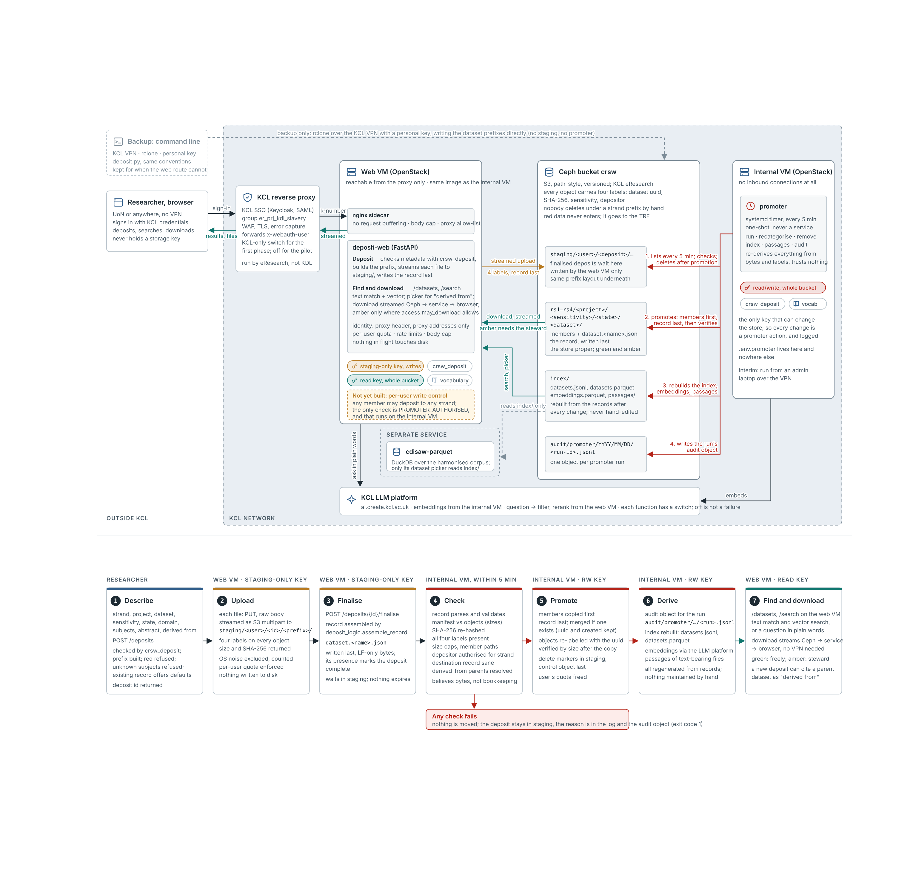

# crsw-data-ingestion-tool

How research data gets into, and is found in, the CRSW shared object
storage (Ceph, S3-compatible, hosted by KCL eResearch). Researchers
describe and upload a dataset through a web form; a separate checker (the
promoter) moves each complete deposit into place and rebuilds the index
that the "Find data" pages read. A command-line tool does the same job
over the KCL VPN and is kept as the backup route. It is not a catalogue
and not a place for red (highly sensitive) data, which goes to the TRE.

**Researchers:** start with [docs/how-to-deposit.md](docs/how-to-deposit.md).

## Diagram



Drawn on the project
[Miro board](https://miro.com/app/board/uXjVEZ1W89g=/), frame "Deposit
tool". Not yet shown in the picture:

- the `centre` strand and the bulk route into it (`crsw_web.bulk`);
- "question → filter" and "ask in plain words" were retired on 22 October 2026;
- programs, installers and macro-enabled Office files are refused at upload;
- the promoter runs on the internal VM's five-minute timer, not from an
  admin laptop.

## Release status

Pilot, live at <https://crsw-deposit.sites.er.kcl.ac.uk> for signed-in
members of the Centre. Current release: v0.21.0, tagged 23 November
2026; the two virtual machines have not yet been deployed to it.

## Install and run

Command line, from a checkout, nothing to install (needs Python 3.8+ and
[rclone](https://rclone.org/downloads/)); `--dry-run` uploads nothing:

```
python deposit.py FILE_OR_FOLDER --strand rs2 --project csac --dataset x --state 2_final --sensitivity green --domain quant --dry-run
```

Web service and nginx, locally, reading `.env` (see `.env.example`):

```
docker compose -f deploy/compose.yaml up --build
```

Tests:

```
python -m unittest
pip install -e ".[web,dev]"
python -m pytest
```

The first runs the conventions and command-line tests on the standard
library alone; the last adds the web service and promoter tests.

## Folder structure

- `crsw_deposit/`: the conventions both routes share (keys, record, manifest, labels, vocabulary).
- `deposit.py`, `transfer.py`: the command-line tool and its rclone calls.
- `crsw_web/`: the web service (deposit form, Find data, search).
- `promoter/`: checks staged deposits, moves them into place, rebuilds the index, keeps the audit trail.
- `deploy/`: Dockerfile, compose file, nginx configuration, the promoter's timer.
- `scripts/`: the no-secrets check and two one-off probes.
- `tests/`: all tests.
- `docs/`: specifications, guides and the runbook.
- `dataset.schema.json`: the contract for the dataset record.
- `crsw-dc-mapping.json`, `export_dcat.py`: the Dublin Core mapping and the DCAT export that uses it.

## Stack

- Command line and `crsw_deposit/`: Python 3.8+, standard library only, plus rclone.
- Web service and promoter: Python 3.12, FastAPI, boto3, DuckDB, in one Docker image with an nginx sidecar.
- Depends on: KCL eResearch Ceph storage, the KCL reverse proxy for sign-in, the public [crsw-vocabulary](https://github.com/kingsdigitallab/crsw-vocabulary) repository, and (optional) the KCL LLM platform for search by meaning.

## Glossary

- **Strand**: one of the Centre's research strands (`rs1` to `rs4`), or `centre` for data the Centre curates itself.
- **State**: how processed the data is: `0_raw`, `1_interim` or `2_final`.
- **Sensitivity**: `green` (open to members) or `amber` (restricted). Red is refused.
- **Member**: one file in a dataset.
- **Record**: `dataset.<name>.json`, the dataset's description and its list of members, written last.
- **Staging**: where the web service puts a deposit; the only place it can write.
- **Promoter**: the checker that moves a complete deposit from staging to its final place.

## Maintainer and contact

Neil Jakeman, King's Digital Lab.

## Where decisions are recorded

- [docs/specs/](docs/specs/): the original brief and revisions r2 to r13; a later revision supersedes an earlier one where it speaks.
- [docs/web-deposit/plan.md](docs/web-deposit/plan.md): the web service's phases and fixed decisions.
- [CLAUDE.md](CLAUDE.md): the constraints and conventions in one place.

## Further reading

- [docs/how-to-deposit.md](docs/how-to-deposit.md): the researcher's guide to the web service.
- [docs/cli-guide.md](docs/cli-guide.md): the command-line tool in full (options, folders, configuration, platform notes).
- [docs/dataset-record.md](docs/dataset-record.md): what the record holds.
- [docs/vocabulary.md](docs/vocabulary.md): subject terms and domains, and how they change.
- [docs/web-deposit/runbook.md](docs/web-deposit/runbook.md): deploying and operating the service.
